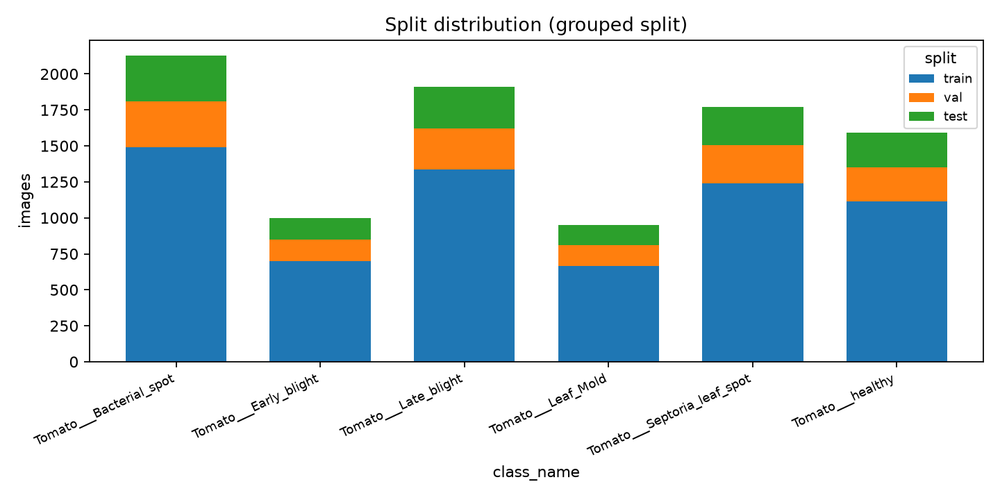

# 数据与实验设置

> 本章由 A 负责，数据事实以 `data/splits/meta.json` 为唯一来源。

## 1. 数据来源

实验使用公开数据集 **PlantVillage**（spMohanty/PlantVillage-Dataset），选取番茄叶片 6 个类别，
原始 **color** 版本共 **9350 张**，单张尺寸 256×256。同源的 **segmented**（去背景）版本随仓库一并
冻结，用于跨域实验（color → segmented，验证模型是否依赖背景）。

| 类别（label 编码顺序固定） | 样本数 |
|---|---|
| Tomato___Bacterial_spot | 2127 |
| Tomato___Early_blight | 1000 |
| Tomato___Late_blight | 1909 |
| Tomato___Leaf_Mold | 952 |
| Tomato___Septoria_leaf_spot | 1771 |
| Tomato___healthy | 1591 |
| **合计** | **9350** |

类别顺序即 label 编码（0–5），全组统一取自 `configs/base.yaml`，任何实验不得改动。

## 2. 去重与防泄漏

PlantVillage 存在大量**同一片叶子的多角度/多次拍摄**，若按图片随机划分，同一叶片的近重复图会
同时落入训练集与测试集，导致指标虚高。因此划分前先做感知哈希聚类：

- 算法：pHash（64 bit），汉明距离阈值 **max_dist = 8**
- 结果：9350 张聚为 **8847 组**，合并 **503 张**近重复图
- 划分单位是**组**而不是图片，同组图片必然落在同一 split

划分文件以 sha256 冻结，任何改动都会被检出：

```
train.csv  80d3b917c6d66fb3bd1557d9aa1deb5575b445bddfa2e46e5c753bcf432f68ce
val.csv    72b4ffa43499cadf6c805dadede3d4c473a09643e68d2e30730cdfd61bfc8a3c
test.csv   40987abfd5218493af594e935015003a37fddd1568db072ff578b0e3ee277609
```

## 3. 划分方案

按组分层抽样，训练/验证/测试 = **70% / 15% / 15%**，并在每个类别内部保持同一比例，
保证各 split 的类别分布一致。

| 类别 | train | val | test | 合计 |
|---|---|---|---|---|
| Tomato___Bacterial_spot | 1489 | 319 | 319 | 2127 |
| Tomato___Early_blight | 700 | 150 | 150 | 1000 |
| Tomato___Late_blight | 1337 | 286 | 286 | 1909 |
| Tomato___Leaf_Mold | 666 | 143 | 143 | 952 |
| Tomato___Septoria_leaf_spot | 1239 | 266 | 266 | 1771 |
| Tomato___healthy | 1113 | 239 | 239 | 1591 |
| **合计** | **6544** | **1403** | **1403** | **9350** |

各类占比在三个 split 中一致（每类均为 70/15/15），验证集仅用于选模型与调参，测试集只在
最终评测时使用。

## 4. 类别不均衡

最大类 2127 张、最小类 952 张，**不均衡比 2.2×**。因此：

- 主指标使用 **macro-F1**（各类等权），准确率仅作参考，避免被大类主导
- `best.pth` 按验证集 **macro-F1** 挑选，而非准确率
- 提供 `class_weight: balanced` 开关作为消融项（E1d），权重**只用训练集计数**计算，
  严禁使用验证/测试集统计量

## 5. 预处理与增强

评测统一使用 `Resize(256) → CenterCrop(224) → ToTensor → Normalize(ImageNet mean/std)`，
所有实验、Demo、Grad-CAM 共用同一条 eval 变换，避免预处理不一致造成的结论偏差。

训练增强通过注册表选择，只允许 `none / basic / strong` 三档（E2 消融即比较这三档）：

| 配方 | 具体操作 |
|---|---|
| none | Resize(256) + CenterCrop(224) |
| basic | Resize(256) + RandomCrop(224) + 水平翻转(p=0.5) + 垂直翻转(p=0.2) + 旋转(±15°) + ColorJitter(0.2,0.2,0.2,0.02) |
| strong | RandomResizedCrop(224, scale=0.6–1.0) + 水平翻转(p=0.5) + RandAugment(n=2, m=9) + RandomErasing(p=0.25) |

## 6. 测试时扰动

鲁棒性实验施加三类退化，severity 1–5 逐级增强，扰动只作用于验证/测试集，训练集始终干净。
扰动直接作用在原始图片上，之后仍走标准 eval 变换。

| 扰动 | 1 | 2 | 3 | 4 | 5 |
|---|---|---|---|---|---|
| brightness（亮度缩放，越小越暗） | 0.90 | 0.75 | 0.60 | 0.45 | 0.30 |
| rotation（旋转角度，度） | 10 | 20 | 30 | 45 | 60 |
| blur（高斯模糊半径） | 0.6 | 1.0 | 1.6 | 2.4 | 3.2 |

severity = 0 表示干净测试集，作为每条曲线的起点。

## 7. 训练与评测设置

| 项 | 取值 |
|---|---|
| 输入尺寸 | 224×224 |
| batch size | 64（显存不足时降至 32） |
| 优化器 | AdamW，backbone / head 分组学习率 |
| 学习率调度 | cosine |
| weight decay | 1e-4（BN 与 bias 不衰减） |
| label smoothing | 0.1 |
| 混合精度 | AMP 开启 |
| 随机种子 | 42 |
| 硬件 | Kaggle GPU（NVIDIA T4） |

## 8. 可复现性

- 划分文件 sha256 冻结，见第 2 节；`data/splits/meta.json` 记录生成时间、随机种子与统计量
- 数据管线提供 9 项自检（`scripts/check_pipeline.py`），在 Kaggle GPU 环境 **9/9 通过**
- 独立复现验证：同一配置（E0，ResNet18 冻结主干，seed 42）在两名成员的机器上分别运行，

| 划分 | 本次复跑 acc / macro-F1 | 结果表已有 acc / macro-F1 | 差值 |
|---|---|---|---|
| val | 0.8931 / 0.8760 | 0.8931 / 0.8768 | ≤ 0.001 |
| test | 0.8974 / 0.8881 | 0.9009 / 0.8907 | 0.0035 |

验证集准确率完全一致，测试集约 0.4 个百分点的差异来自 GPU 与算子版本的非确定性，
处于可接受范围，说明流程可复现。



*图 1：六个类别的样本数分布，最大/最小类相差 2.2 倍。*
