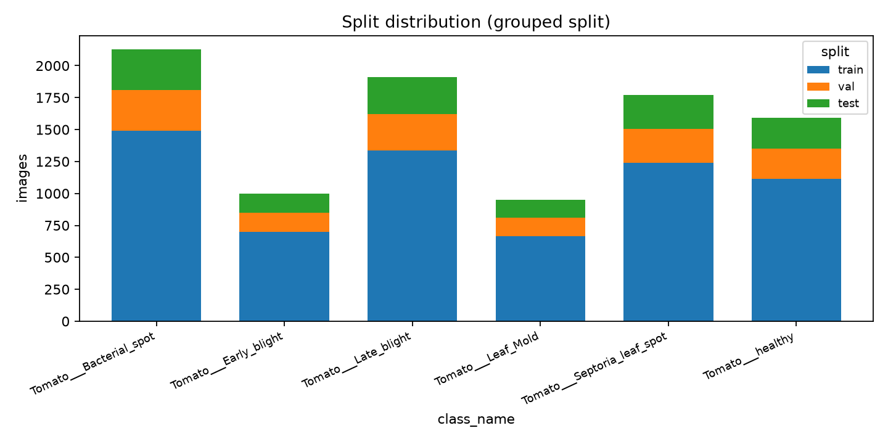
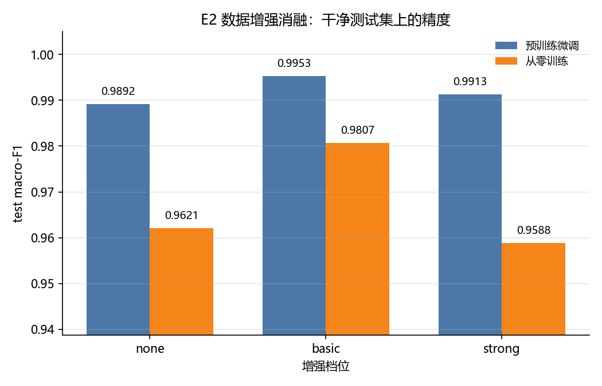
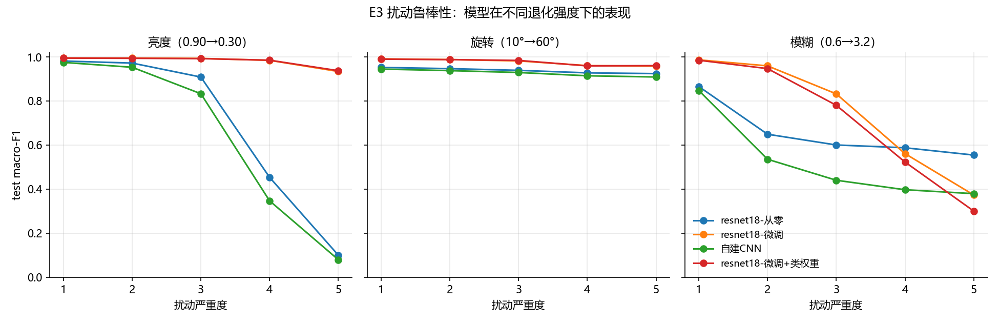
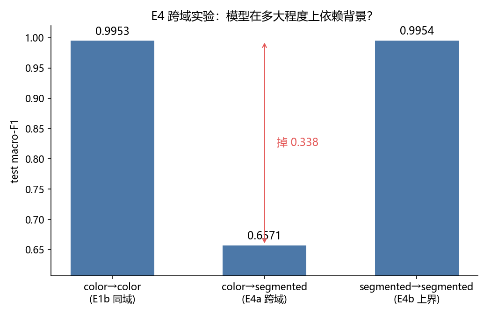
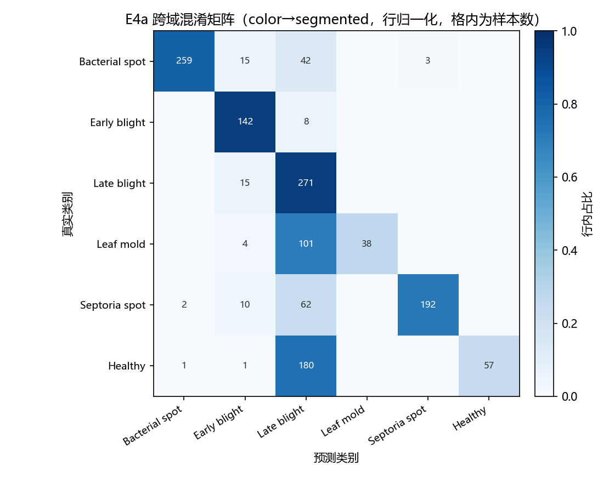
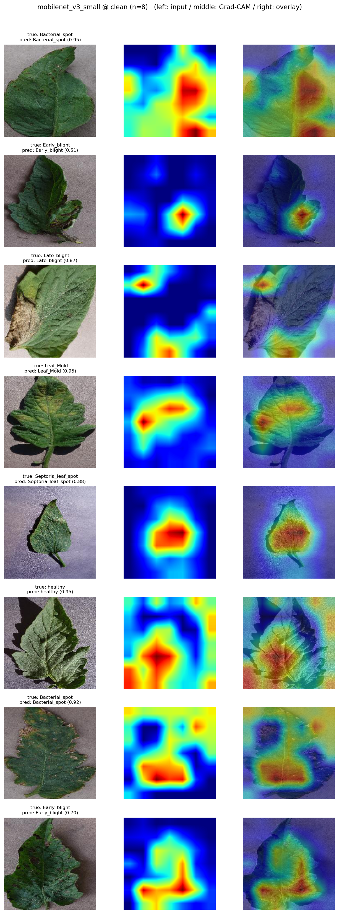
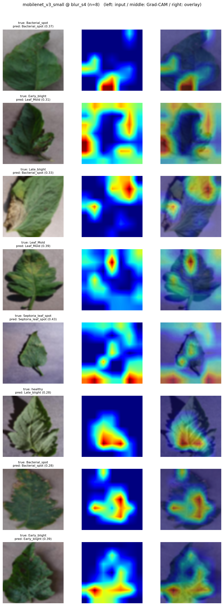

# 摘要

本文以 PlantVillage 番茄 6 类叶片病害为对象，在统一、可复现的评测协议下回答四个问题：预训练权重贡献多少、
数据增强应该怎么配、模型对常见退化有多鲁棒、精度在多大程度上依赖背景。实验覆盖 6 个模型（冻结主干、从零训练、
全量微调、类别加权、自建 CNN、mobilenet_v3_small）、三档增强的消融、3 类扰动 × 5 档严重度共 60 次评测，
以及 color → segmented 的跨域对照。

结果表明：同域任务已接近饱和，最优 test macro-F1 为 0.9958（mobilenet_v3_small 微调），
resnet18 微调为 0.9953，模型间差异处于单 seed 噪声内。预训练的价值主要体现在鲁棒性——亮度退化最严重一档
仍保持 0.9340，而两个从零训练的模型跌至 0.0997 / 0.0793。增强档位以 `basic` 最稳：从零训练时它比
`none` / `strong` 高约 2 个百分点，微调时三档差异在噪声范围内，`strong` 未带来收益。跨域实验中，
color → segmented 的 macro-F1 降至 0.6571（−0.338），而 segmented 域内训练可达 0.9954，
说明模型大量利用了与病斑无关的背景线索，**背景依赖是首要局限**。据此，99.5% 应被理解为域内指标，
不能直接作为真实田间的精度预期；模型选择上，mobilenet_v3_small 微调在精度持平时把参数量降到 1/7，
可用于端侧部署。

本研究的局限在于单 seed 运行、单一数据集、合成扰动与缺少田间实拍验证，因此小于 0.5 个百分点的差异不作结论使用。
后续工作应优先降低背景依赖（背景随机化、混合域训练、目标域小样本适应），并补多种子、配对显著性检验与
推荐模型的扰动评测。

**关键词**：植物病害识别；迁移学习；数据增强；鲁棒性；数据集偏差；背景依赖

---

# 引言

> 全文编排：引言（前置，不单独编号）→ 第 1 章 数据与实验设置（`data_and_setup.md`）→ 第 2 章 方法（`method.md`）
> → 第 3 章 结果与分析（`results.md`）→ 专题 可解释性与交互式 Demo（`interpretability.md`）
> → 第 4 章 结论与展望（`conclusion.md`）→ 参考文献（`references.md`）。
> 摘要见 `abstract.md`（置于引言之前），关键词附于摘要末尾；E2 结果已入库，摘要已按 `results/results.csv` 定稿。

## 1. 研究背景

番茄是重要的经济作物，叶部病害（细菌性斑点病、早疫病、晚疫病、叶霉病、斑枯病等）直接影响产量与品质。
传统诊断依赖植保人员现场识别，成本高、时效差，且基层缺少专业人员。基于手机或无人机的叶片图像自动诊断，
因此成为一个现实需求明确的视觉分类问题。

PlantVillage[1] 是目前使用最广的公开叶片图像数据集，其番茄子集覆盖 6 个常见类别，为算法对比提供了统一起点。
Mohanty 等[2] 在该数据集上报告了 99% 以上的识别精度，此后大量工作沿用这一基准。但同一批作者也指出：
把在 PlantVillage 上训练的模型直接用于真实田间照片时，精度会明显下降。Barbedo[3] 进一步系统分析后认为，
数据集规模、拍摄条件与背景差异是限制模型可迁移性的主要原因。

这意味着：**在 PlantVillage 上把准确率从 99.5% 提到 99.7%，其实际意义有限**。真正决定这类模型能否落地的问题，
是精度究竟来自哪里、在什么条件下会失效。本项目即围绕这一判断组织实验。

## 2. 问题设定与研究问题

本研究以番茄 6 类叶片病害分类为载体，在**统一协议**下（同一份冻结划分、同一条评测变换、同一张结果长表）
考察四个问题：

- **RQ1：预训练权重贡献多少？** 在骨干、增强、划分完全相同的条件下，对比冻结主干（E0）、从零训练（E1a）、
  全量微调（E1b）与自建轻量 CNN（E1c），区分"结构收益"与"预训练权重收益"。
- **RQ2：数据增强怎么配？** 在 `none / basic / strong` 三档增强下，比较预训练与从零训练两条线的干净测试集精度，
  并观察增强是否以域内掉点为代价换取鲁棒性（E2）。
- **RQ3：模型对常见退化有多鲁棒？** 按亮度、旋转、高斯模糊三类退化各设 5 档严重度，对 4 个模型做 60 次评测，
  给出 macro-F1 随退化强度的变化曲线（E3）。
- **RQ4：模型在多大程度上依赖背景？** 用 color 训练的权重在去背景（segmented）版本上直接评测，
  并以 segmented 域内训练的结果作为上界对照，量化"背景依赖"造成的落差（E4）。

另设一组规模与成本对照（E1e，mobilenet_v3_small），回答"在精度持平时能否用更小的模型"。

## 3. 主要工作

1. **一份可复现的评测协议**：pHash 近重复聚类后按组划分（70/15/15），划分文件以 sha256 冻结；
   评测统一为 `Resize(256) → CenterCrop(224) → Normalize`，训练/评测/Demo/Grad-CAM 共用；
   所有结果以长表写入 `results/results.csv`，由脚本聚合为 `summary.csv` 并生成全部图表。
2. **同域精度与成本的完整对照**：6 个模型（含冻结、从零、微调、类别加权、轻量骨干）在主指标上的一致性对比，
   并附参数量、FLOPs、GPU/CPU 推理延迟实测。
3. **一张 60 次的扰动评测网格**：3 类退化 × 5 档严重度 × 4 个模型，且同一网格在两台机器上复跑校验一致性，
   用于区分"起点高"与"抗退化"。
4. **一组跨域对照实验**：color → segmented 的零样本评测，加上 segmented → segmented 的域内上界，
   把跨域落差归因到背景而不是"任务本身更难"。
5. **可解释性证据**：在 clean 与强模糊条件下用 Grad-CAM 观察模型关注区域的变化（见"可解释性与交互式 Demo"专题）。

## 4. 主要发现（预告）

- 同域条件下，任务已接近饱和：最优 test macro-F1 为 **0.9953–0.9958**，模型间差距在单 seed 噪声内。
- 预训练的主要价值不在同域精度（仅约 1.5 个百分点），而在**抗退化能力**：亮度退化最严重一档，
  微调模型仍保持 0.93 左右，两个从零训练的模型跌到 0.10 / 0.08。
- 跨域（color → segmented）macro-F1 由 0.9953 降至 **0.6571（−0.338）**，且 segmented 域内训练可达 0.9954，
  说明**背景依赖是本项目观察到的首要局限**，也是"99.5%"这一数字不能直接作为部署承诺的原因。
- 类别加权对精度与鲁棒性均无系统性改善；增强策略上 `basic` 为最优档，`strong` 属过增强（从零训练掉 2.2 个百分点）。

## 5. 全文结构

- **第 1 章 数据与实验设置**：数据来源、去重与防泄漏、划分方案、预处理与增强、扰动刻度、训练超参。
- **第 2 章 方法**：整体框架、模型与训练策略、增强消融设计、评测协议、实验矩阵、结果记录与可复现性。
- **第 3 章 结果与分析**：主结果、预训练消融、规模与成本、类别加权、增强消融、扰动鲁棒性、跨域对照、统计可靠性。
- **专题 可解释性与交互式 Demo**：Grad-CAM 在干净 / 模糊输入下的对比、Demo 用法与复现方式。
- **第 4 章 结论与展望**：结论汇总、首要局限（背景依赖）、其他局限与后续工作。
- **参考文献**。

---

# 第 1 章 数据与实验设置

> 本章由 A 负责，数据事实以 `data/splits/meta.json` 为唯一来源。

## 1. 数据来源

实验使用公开数据集 **PlantVillage**（spMohanty/PlantVillage-Dataset），选取番茄叶片 6 个类别，
原始 **color** 版本共 **9350 张**，单张尺寸 256×256。同源的 **segmented**（去背景）版本随仓库一并
冻结，用于跨域实验（color → segmented，验证模型是否依赖背景）。

| 类别（label 编码顺序固定） | 样本数 |
|---|---|
| Tomato___Bacterial_spot | 2127 |
| Tomato___Early_blight | 1000 |
| Tomato___Late_blight | 1909 |
| Tomato___Leaf_Mold | 952 |
| Tomato___Septoria_leaf_spot | 1771 |
| Tomato___healthy | 1591 |
| **合计** | **9350** |

类别顺序即 label 编码（0–5），全组统一取自 `configs/base.yaml`，任何实验不得改动。

## 2. 去重与防泄漏

PlantVillage 存在大量**同一片叶子的多角度/多次拍摄**，若按图片随机划分，同一叶片的近重复图会
同时落入训练集与测试集，导致指标虚高。因此划分前先做感知哈希聚类：

- 算法：pHash（64 bit），汉明距离阈值 **max_dist = 8**
- 结果：9350 张聚为 **8847 组**，合并 **503 张**近重复图
- 划分单位是**组**而不是图片，同组图片必然落在同一 split

划分文件以 sha256 冻结，任何改动都会被检出：

```
train.csv  80d3b917c6d66fb3bd1557d9aa1deb5575b445bddfa2e46e5c753bcf432f68ce
val.csv    72b4ffa43499cadf6c805dadede3d4c473a09643e68d2e30730cdfd61bfc8a3c
test.csv   40987abfd5218493af594e935015003a37fddd1568db072ff578b0e3ee277609
```

## 3. 划分方案

按组分层抽样，训练/验证/测试 = **70% / 15% / 15%**，并在每个类别内部保持同一比例，
保证各 split 的类别分布一致。

| 类别 | train | val | test | 合计 |
|---|---|---|---|---|
| Tomato___Bacterial_spot | 1489 | 319 | 319 | 2127 |
| Tomato___Early_blight | 700 | 150 | 150 | 1000 |
| Tomato___Late_blight | 1337 | 286 | 286 | 1909 |
| Tomato___Leaf_Mold | 666 | 143 | 143 | 952 |
| Tomato___Septoria_leaf_spot | 1239 | 266 | 266 | 1771 |
| Tomato___healthy | 1113 | 239 | 239 | 1591 |
| **合计** | **6544** | **1403** | **1403** | **9350** |

各类占比在三个 split 中一致（每类均为 70/15/15），验证集仅用于选模型与调参，测试集只在
最终评测时使用。

## 4. 类别不均衡

最大类 2127 张、最小类 952 张，**不均衡比 2.2×**。因此：

- 主指标使用 **macro-F1**（各类等权），准确率仅作参考，避免被大类主导
- `best.pth` 按验证集 **macro-F1** 挑选，而非准确率
- 提供 `class_weight: balanced` 开关作为消融项（E1d），权重**只用训练集计数**计算，
  严禁使用验证/测试集统计量

## 5. 预处理与增强

评测统一使用 `Resize(256) → CenterCrop(224) → ToTensor → Normalize(ImageNet mean/std)`，
所有实验、Demo、Grad-CAM 共用同一条 eval 变换，避免预处理不一致造成的结论偏差。

训练增强通过注册表选择，只允许 `none / basic / strong` 三档（E2 消融即比较这三档）：

| 配方 | 具体操作 |
|---|---|
| none | Resize(256) + CenterCrop(224) |
| basic | Resize(256) + RandomCrop(224) + 水平翻转(p=0.5) + 垂直翻转(p=0.2) + 旋转(±15°) + ColorJitter(0.2,0.2,0.2,0.02) |
| strong | RandomResizedCrop(224, scale=0.6–1.0) + 水平翻转(p=0.5) + RandAugment(n=2, m=9) + RandomErasing(p=0.25) |

## 6. 测试时扰动

鲁棒性实验施加三类退化，severity 1–5 逐级增强，扰动只作用于验证/测试集，训练集始终干净。
扰动直接作用在原始图片上，之后仍走标准 eval 变换。

| 扰动 | 1 | 2 | 3 | 4 | 5 |
|---|---|---|---|---|---|
| brightness（亮度缩放，越小越暗） | 0.90 | 0.75 | 0.60 | 0.45 | 0.30 |
| rotation（旋转角度，度） | 10 | 20 | 30 | 45 | 60 |
| blur（高斯模糊半径） | 0.6 | 1.0 | 1.6 | 2.4 | 3.2 |

severity = 0 表示干净测试集，作为每条曲线的起点。

## 7. 训练与评测设置

| 项 | 取值 |
|---|---|
| 输入尺寸 | 224×224 |
| batch size | 64（显存不足时降至 32） |
| 优化器 | AdamW，backbone / head 分组学习率 |
| 学习率调度 | cosine |
| weight decay | 1e-4（BN 与 bias 不衰减） |
| label smoothing | 0.1 |
| 混合精度 | AMP 开启 |
| 随机种子 | 42 |
| 硬件 | Kaggle GPU（NVIDIA T4） |

## 8. 可复现性

- 划分文件 sha256 冻结，见第 2 节；`data/splits/meta.json` 记录生成时间、随机种子与统计量
- 数据管线提供 9 项自检（`scripts/check_pipeline.py`），在 Kaggle GPU 环境 **9/9 通过**
- 独立复现验证：同一配置（E0，ResNet18 冻结主干，seed 42）在两名成员的机器上分别运行，

| 划分 | 本次复跑 acc / macro-F1 | 结果表已有 acc / macro-F1 | 差值 |
|---|---|---|---|
| val | 0.8931 / 0.8760 | 0.8931 / 0.8768 | ≤ 0.001 |
| test | 0.8974 / 0.8881 | 0.9009 / 0.8907 | 0.0035 |

验证集准确率完全一致，测试集约 0.4 个百分点的差异来自 GPU 与算子版本的非确定性，
处于可接受范围，说明流程可复现。



*图 1：六个类别的样本数分布，最大/最小类相差 2.2 倍。*

---

# 第 2 章 方法

> 本章说明"怎么做"：整体框架、模型与训练策略、增强消融的设计、评测协议与实验矩阵。
> 数据来源、划分统计与超参取值以第 1 章（`data_and_setup.md`）为唯一来源，本章只在需要时引用，不重复罗列数字。

## 1. 总体框架

整个研究按"固定协议 → 单变量对照 → 统一评测 → 集中汇总"四步组织：

1. **固定协议**：数据划分、评测变换、指标与结果表格式一次冻结，任何实验不得改动。
2. **单变量对照**：每个实验族只改变一个因素（是否预训练、是否冻结、增强档位、是否加权、测试域），
   其余条件与基线保持一致，保证差值是"这一项"的贡献。
3. **统一评测**：所有模型都走 `src/eval.py` 与同一条 eval 变换，扰动实验也只替换输入图像，不改预处理。
4. **集中汇总**：一行一次评测写入 `results/results.csv`（长表），再由 `src/utils/table.py` 聚合为
   `summary.csv`，图表由 `scripts/make_figures.py` 从同一份 CSV 生成，做到"改数据即可重画"。

## 2. 数据与划分（摘要）

- 原始数据为 PlantVillage color 版本番茄 6 类，共 9350 张，256×256；同一份数据的 segmented（去背景）版本用于跨域实验。
- 划分前用 pHash 感知哈希[15]做近重复聚类（汉明距离阈值 8），9350 张聚为 8847 组，避免同一片叶子的多张照片
  跨训练/测试集造成虚高。
- 以**组**为单位按类分层划分 70/15/15（6544 / 1403 / 1403），划分文件以 sha256 冻结。
- segmented 与 color 共用同一份划分文件，保证跨域比较时"测试图与训练图同组不跨 split"这一前提不被破坏。

细节与统计见第 1 章第 2、3 节。

## 3. 模型

| 代号 | 模型 | 预训练 | 参数量 | 角色 |
|---|---|---|---|---|
| E0 | resnet18[5] | ImageNet[4] | 11.18M | 冻结主干，只训分类头，链路基准 |
| E1a | resnet18[5] | 无 | 11.18M | 从零训练，衡量预训练收益的下界 |
| E1b | resnet18[5] | ImageNet[4] | 11.18M | 全量微调，主基线 |
| E1c | 自建 4-block CNN | 无 | 1.17M | 结构对照（非主流骨干的能力上限） |
| E1d | resnet18[5] | ImageNet[4] | 11.18M | 与 E1b 仅差类别加权 |
| E1e | mobilenet_v3_small[6] | ImageNet[4] | 1.52M | 轻量骨干，精度/成本折中 |

三者（含自建 CNN）都拆分为 `.backbone / .head` 结构，训练脚本只按 `freeze_backbone` 决定哪些参数参与更新，
因此"冻结 / 微调 / 从零"三种策略可以在不改模型代码的前提下切换。

## 4. 训练策略

所有训练共用一套设置，唯一差异写在 yaml 里：

| 项 | 取值 | 说明 |
|---|---|---|
| 优化器 | AdamW[12] | 解耦权重衰减 |
| 学习率 | backbone 1e-4 / head 1e-3（从零训练时统一 1e-3） | 分组设置，兼顾微调与随机初始化 head |
| 调度 | cosine | 按总 epoch 退火 |
| weight decay | 1e-4 | BN 与 bias 不参与衰减 |
| label smoothing | 0.1[13] | 缓解过拟合与过度自信 |
| 批大小 / 输入 | 64 / 224×224 | 显存不足时降至 32 |
| 混合精度 | 开启 | Kaggle T4 |
| 模型选择 | 验证集 macro-F1 | `best.pth` 不按准确率挑选 |

E0 通过 `freeze_backbone: true` 只更新分类头；`pretrained: false` 时该开关被忽略（避免"冻结随机初始化主干"的无效配置）。

## 5. 增强策略与 E2 消融设计

三档增强由注册表选择，只允许 `none / basic / strong`，具体操作见第 1 章第 5 节，此处只说明设计意图：

- `none`：只做确定性的 `Resize + CenterCrop`，代表"无随机性"的极端。
- `basic`：几何 + 翻转 + 轻度颜色抖动，是常规默认档。
- `strong`：`RandomResizedCrop` + `RandAugment`[9] + `RandomErasing`[10]，代表激进档（数据增强综述见[8]）。

E2 采用 **2×3 设计**：{none, basic, strong} × {预训练微调, 从零训练}。其中 `basic` 一行直接复用 E1b / E1a 的既有结果，
因此只需新跑 4 组（`e2a_aug_none`、`e2a_aug_none_scratch`、`e2c_aug_strong`、`e2c_aug_strong_scratch`）。
两列各自的 `basic` 臂与其余臂共用同一骨干、同一学习率、同一 epoch 数，**唯一变量是 `train.aug`**，
从而保证"增强档位"的差值可解释。

配置文件的约定是：同一增强档位下，微调与从零两臂共用 `exp_id`（`e2a` / `e2c`），靠 `model` 与 `pretrained` 两列区分；
汇总时按 `exp_id + 配置列` 分组，不会把两条臂平均成一行。

E2 的结果与结论见第 3 章第 5 节：`none / basic / strong` 在微调与从零两条线上排序一致，`basic` 均为最优点，
`strong` 属过增强；`strong` 是否以域内掉点为代价换取鲁棒性提升，尚未评测。

## 6. 评测协议

1. **干净测试集**：1403 张，`corruption=clean, severity=0`，报告 acc 与 macro-F1，主指标为 macro-F1
   （类别不均衡比 2.2×，等权才能反映小类表现）。
2. **扰动测试集**：亮度、旋转、高斯模糊三类，各设 5 档严重度（刻度见第 1 章第 6 节）。退化施加在**原始图片**上，
   之后仍走标准 eval 变换；训练集始终保持干净，避免"训练时见过退化"混淆结论。
   该设置借鉴常见退化基准[7]的思路，但参数按叶片图像的可辨识度自行标定，而非直接套用 ImageNet-C。
3. **逐类分析**：除整体指标外，取逐类召回率与主要误判去向，用于判断退化/跨域是否是"均匀掉点"
   还是"特定类别崩塌"——后者往往指向捷径特征（如背景）。
4. **起点一致性**：每条扰动曲线的 severity = 0 点取该模型的干净测试集结果，确保曲线的落差是退化造成的，
   而不是两次评测的偶然差异。

## 7. 实验矩阵

| 实验 | 自变量 | 评测对象 | 是否需训练 | 对应章节 |
|---|---|---|---|---|
| E0 | 冻结主干 vs 放开 | val/test 干净 | 是（只训 head） | 3.1、3.2 |
| E1a / E1b | 是否预训练 | val/test 干净 | 是 | 3.2 |
| E1c | 骨干结构（自建 CNN） | val/test 干净 | 是 | 3.1、3.2 |
| E1d | 类别加权 | val/test 干净 | 是 | 3.4 |
| E1e | 轻量骨干 | val/test 干净 + 成本实测 | 是 | 3.1、3.3 |
| E2 | 增强档位 × 是否预训练 | val/test 干净 | 是（4 组新增） | 3.5 |
| E3 | 退化类型 × 严重度 | test（退化） | 否（复用权重评测） | 3.6 |
| E4a | 测试域（color → segmented） | test（跨域） | 否 | 3.7 |
| E4b | 训练域（segmented 域内） | val/test（segmented） | 是 | 3.7 |

"是否需训练"这一列决定了实验能否在无 GPU 环境复现：E3、E4a 只做评测，可在 CPU 上重跑校验；
其余需要训练的实验均应记录完整配置与随机种子。

## 8. 结果记录与可复现

- **结果长表**：`results/results.csv` 一行一次评测，字段固定为
  `exp_id, model, pretrained, aug, seed, data_ratio, split, corruption, severity, acc, macro_f1, params_m, notes`，
  只追加不改写；写入统一走 `src.utils.table.append_row`。
- **汇总**：`python -m src.utils.table --path results/results.csv --out results/summary.csv`，
  按 `exp_id` 与配置列分组，给出 `n_seeds`、均值与标准差（当前均为单 seed，见第 3 章第 8 节）。
- **产物目录**：`runs/<run_name>/best.pth`、`metrics.json`（训练曲线与最优 epoch）、评测产生的 `eval.json`；
  命名规范为`实验_模型_是否预训练_数据比例_seed`。
- **图表**：全部由 `scripts/make_figures.py` 从 `results.csv` 生成，报告中引用的图片与脚本产出保持同一来源。
- **复现校验**：同一配置（E0）在两台机器上复跑，val 指标完全一致、test 差异约 0.4 个百分点（算子版本非确定性），
  见第 1 章第 8 节。
- **已知缺口**：目前全部结果均为 seed 42 单次运行，未给出标准差，也未做配对显著性检验（McNemar[14]），
  因此小于 0.5 个百分点的差异不作结论使用（第 3 章第 8 节、第 4 章第 3 节）。

## 9. 方法层面的局限

- 只有单一数据集、单一作物（番茄 6 类），"泛化"仅指拍摄域（背景）变化，不涉及新的作物或新的病害类别。
- 扰动为合成退化，与真实场景中的运动模糊、过曝、遮挡、病害不同阶段存在差距。
- 评测以图像级分类为单位，未涉及检测/分割定位，也未涉及田间部署的实时性与功耗约束（仅实测推理延迟作参考）。

---

# 第 3 章 实验结果与分析

> 本章由 D 负责。所有数字取自 `results/results.csv`（按 `exp_id` 汇总到 `results/summary.csv`），
> 图由 `scripts/make_figures.py` 从同一份 CSV 生成，可一键复现。
> 当前所有结果均为 **seed 42 单次运行**，标准差尚未统计，见第 8 节的说明。

## 1. 主结果

六个模型在干净测试集（1403 张）上的表现如下，验证集仅用于挑选 `best.pth`：

| 实验 | 模型 | 预训练 | 训练策略 | 参数量 | val acc / macro-F1 | **test acc / macro-F1** |
|---|---|---|---|---|---|---|
| E0 | resnet18 | ✓ | 冻结主干，只训分类头 | 11.18M | 0.8931 / 0.8768 | 0.9009 / 0.8907 |
| E1a | resnet18 | ✗ | 从零训练，basic 增强 | 11.18M | 0.9857 / 0.9843 | 0.9815 / 0.9807 |
| **E1b** | resnet18 | ✓ | 全量微调，basic 增强 | 11.18M | 0.9971 / 0.9971 | **0.9957 / 0.9953** |
| E1c | 自建 CNN | ✗ | 从零训练，basic 增强 | 1.17M | 0.9786 / 0.9779 | 0.9758 / 0.9745 |
| E1d | resnet18 | ✓ | 全量微调 + 类别加权 | 11.18M | 0.9979 / 0.9980 | 0.9950 / 0.9950 |
| **E1e** | mobilenet_v3_small | ✓ | 全量微调，basic 增强 | 1.52M | 0.9929 / 0.9926 | **0.9957 / 0.9958** |

E1b 的逐类召回率均在 0.993 以上（最差类别为 Late_blight 0.9930），六类之间没有明显短板，
说明在**同域（color → color）**条件下，任务本身对当前模型已接近饱和。

## 2. 预训练权重是精度的主要来源

同一骨干、同一增强、同一划分下的三组对照：

| 对照 | test macro-F1 | 差值 |
|---|---|---|
| E0 冻结主干（仅训头） | 0.8907 | 基准 |
| E1a 从零训练全网络 | 0.9807 | +0.090 |
| E1b 全量微调 | 0.9953 | +0.105 |

两个结论：

1. **放开主干比冻结主干值 9 个百分点**——PlantVillage 的判别信息在浅层特征里就有，但需要微调才能适配叶片纹理。
2. **从零训练已经是强基线（0.98）**，只比微调低 1.5 个百分点。这与"自然图像预训练对细粒度分类增益有限"的常见观察一致：数据集规模足够（6544 张训练集）、类间差异明显（病斑形态），从零训练并非不可行。

因此"预训练是否必要"要分开看：同域精度上收益 1.5 点，但在**分布偏移**下的收益远大于此（见第 6、7 节）。

## 3. 模型规模与推理成本

`results/model_cost.csv` 在 RTX 4060 Laptop（batch=1，torch 2.8.0）与同机 CPU 上的实测：

| 模型 | 参数量 | FLOPs | GPU 延迟 | GPU FPS | CPU 延迟 | CPU FPS |
|---|---|---|---|---|---|---|
| 自建 CNN（E1c） | 1.17M | 5.17G | 1.18 ms | 845 | 22.5 ms | 44.5 |
| mobilenet_v3_small（E1e） | 1.52M | 0.11G | 3.98 ms | 251 | 20.8 ms | 48.2 |
| resnet18（E1b） | 11.18M | 3.63G | 1.94 ms | 514 | 28.7 ms | 34.9 |

需要注意的自建 CNN 反常之处：参数量只有 resnet18 的 1/10，但 FLOPs 高出 42%，原因是它在 224×224 分辨率上直接使用大通道卷积，缺乏下采样；
这也解释了它在 CPU 上并不比 resnet18 快多少。mobilenet_v3_small 的 FLOPs 比 resnet18 低 **33 倍**，
但单张延迟反而更慢（3.98 ms vs 1.94 ms），原因是深度可分离卷积的算子效率低、GPU 上无法打满。

**选型建议**：若追求精度上限，用 **E1e（mobilenet_v3_small 微调）**——test macro-F1 0.9958 为全组最高，
参数量仅为 resnet18 的 14%；端侧 CPU 部署二者相差不大（20.8 ms vs 28.7 ms），mobilenet 略优。

## 4. 类别不均衡与类别加权（E1d）

不均衡比 2.2×（第 1 章第 4 节），但 E1b 与 E1d 的差距在 0.0005 以内：

| | val macro-F1 | test macro-F1 |
|---|---|---|
| E1b 不加权 | 0.9971 | 0.9953 |
| E1d `class_weight: balanced` | 0.9980 | 0.9950 |

结论：**在本数据集的规模与类间可分性下，类别加权没有必要**。加权只是把决策边界往小类推，
代价是大类（Bacterial_spot 2127 张）略微受损，净效果在单 seed 噪声范围内。默认配置保留不加权。

## 5. 数据增强消融（E2）

三档增强由 `aug` 名字选择，定义在 `src/data/transforms.py`：

| 档位 | 配方 |
|---|---|
| `none` | Resize(256) + CenterCrop(224) |
| `basic` | Resize(256) + RandomCrop(224) + 水平翻转 0.5 + 垂直翻转 0.2 + 旋转 ±15° + ColorJitter(0.2, 0.2, 0.2, 0.02) |
| `strong` | RandomResizedCrop(224, scale=0.6–1.0) + 水平翻转 0.5 + RandAugment(2, 9) + RandomErasing(0.25) |

四个新配置（`e2a_aug_none`、`e2c_aug_strong` 及其 scratch 版本）与 E1a / E1b 的 `basic` 臂
构成 2×3 网格，全部 seed 42、15 epochs、同一冻结划分：

| 增强 | resnet18 微调 | resnet18 从零 |
|---|---|---|
| none | 0.9892（E2a，val 0.9937） | 0.9621（E2a scratch，val 0.9584） |
| **basic** | **0.9953**（E1b，val 0.9971） | **0.9807**（E1a，val 0.9843） |
| strong | 0.9913（E2c，val 0.9951） | 0.9588（E2c scratch，val 0.9580） |

*表内为 test macro-F1，括号内为 val macro-F1；E2a / E2c 的微调与从零两臂通过 `pretrained` 区分。*



*图 2：三档增强在微调 / 从零两条线上的干净测试集 macro-F1（纵轴自 0.94 起截断，用于看清组间差异）。*

三点观察：

1. **`basic` 在两种训练模式下都是最优点**：相对 `none`，从零训练 +0.0186（远超单 seed 噪声），
   微调 +0.0061（略高于 0.5 点噪声界，但幅度有限）。
   翻转 + 小角度旋转 + 温和色彩抖动补上了 PlantVillage 拍摄角度与光照的多样性，又没有破坏病斑形态。
2. **`strong` 属于过增强**：相对 `basic`，从零训练 −0.0219（明显），微调 −0.0040（在噪声范围内）。
   RandAugment(2, 9) 叠加 RandomErasing 后，判别所需的局部纹理被大量遮盖/扰动，
   在 6544 张训练集规模下从零训练的模型来不及从剩余信息中收敛。
3. **增强的收益与预训练互补**：从零训练从增强中获得 1.86 个点，是微调（0.61 点）的 3 倍，
   说明预训练权重本身已携带平移/色彩不变性，增强对缺少该先验的模型更关键。

一处说明：E3 的鲁棒性曲线用的都是 `basic` 权重，因此**"`strong` 是否用干净精度换来了退化鲁棒性"本组未评测**。
若要回答，需在 `scripts/eval_corruptions.py` 的 `CKPT_BUNDLES` 里加一条 E2c 的配置与权重，
重跑 E3 的 60 组网格，列入后续工作。

## 6. 扰动鲁棒性（E3）

4 个模型 × 3 类扰动 × 5 档严重度，共 60 次评测（参数刻度见第 1 章第 6 节）。
干净测试集（severity = 0）作为每条曲线的起点。同一网格在两名成员机器上各跑过一遍，
60 组结果逐行一致（最大差 0.002），见 PR #7 与本章提交记录的比对说明。本章三个表格统一取自 `results/results.csv`。

**亮度（brightness，0.90 → 0.30）**

| 模型 | 1 | 2 | 3 | 4 | 5 | 1→5 跌幅 |
|---|---|---|---|---|---|---|
| E1a resnet18 从零 | 0.9815 | 0.9722 | 0.9087 | 0.4532 | 0.0997 | **−0.882** |
| E1b resnet18 微调 | 0.9956 | 0.9951 | 0.9934 | 0.9846 | 0.9340 | −0.062 |
| E1c 自建 CNN | 0.9753 | 0.9532 | 0.8330 | 0.3466 | 0.0793 | **−0.896** |
| E1d resnet18 微调+类权重 | 0.9948 | 0.9939 | 0.9925 | 0.9853 | 0.9377 | −0.057 |

**旋转（rotation，10° → 60°）**

| 模型 | 1 | 2 | 3 | 4 | 5 | 1→5 跌幅 |
|---|---|---|---|---|---|---|
| E1a | 0.9525 | 0.9469 | 0.9392 | 0.9278 | 0.9243 | −0.028 |
| E1b | 0.9915 | 0.9881 | 0.9820 | 0.9607 | 0.9582 | −0.033 |
| E1c | 0.9450 | 0.9379 | 0.9294 | 0.9145 | 0.9090 | −0.036 |
| E1d | 0.9901 | 0.9879 | 0.9843 | 0.9595 | 0.9606 | −0.030 |

**模糊（blur，0.6 → 3.2）**

| 模型 | 1 | 2 | 3 | 4 | 5 | 1→5 跌幅 |
|---|---|---|---|---|---|---|
| E1a | 0.8658 | 0.6491 | 0.6005 | 0.5876 | 0.5545 | −0.311 |
| E1b | 0.9868 | 0.9596 | 0.8324 | 0.5611 | 0.3733 | **−0.614** |
| E1c | 0.8477 | 0.5354 | 0.4401 | 0.3970 | 0.3792 | −0.469 |
| E1d | 0.9850 | 0.9471 | 0.7806 | 0.5229 | 0.3002 | **−0.685** |



*图 3：三种扰动的 macro-F1 随严重度变化。左：亮度；中：旋转；右：模糊。*

三点观察：

1. **亮度是区分"是否预训练"的分水岭**。预训练模型在 0.60 的暗度下几乎不掉点（0.993），
   而两个从零训练的模型在 severity 3→4 之间出现断崖（0.91 → 0.45 / 0.35），最暗处只剩 0.10 / 0.08。
   这不能用"图像变暗 = 像素均值偏移"简单解释：标准 eval 变换里的 ImageNet 归一化对亮度变化是等比例的，
   更可能的原因是预训练权重里已有的、对光照不敏感的颜色/纹理表征，从零训练在 6544 张图上没有学到。
2. **模糊对所有模型都是最难的一类**，且预训练模型的绝对跌幅最大（−0.61 / −0.69），
   但这只是因为它起点高：severity 5 时 E1b（0.373）仍与 E1c（0.379）持平。
   换句话说，模糊把"预训练带来的优势"基本抹平了——细粒度病斑依赖高频纹理，
   高斯模糊直接把判别信号去掉，此时所有模型都接近随机猜测以上的下限。
3. **旋转几乎无影响**（四个模型跌幅均 ≤ 0.036），说明模型对叶片的朝向不敏感，
   这与 `basic` 增强里已有 ±15° 旋转、且叶片本身近似各向同性有关。
4. 类别加权（E1d）对鲁棒性**没有系统性改善**：亮度/旋转与 E1b 相差 ≤ 0.004，模糊甚至略差（−0.685 vs −0.614），
   说明加权只改变决策边界位置，不改变特征对退化的敏感度。

## 7. 背景依赖：color → segmented 跨域（E4）

用 E1b 的权重（在 color 上训练）直接评测 segmented 测试集，与两个同域上界/下界对比：

| 设置 | test acc | test macro-F1 | 相对 ① 的落差 |
|---|---|---|---|
| ① color → color（E1b 同域） | 0.9957 | 0.9953 | — |
| ② color → segmented（E4a 跨域） | 0.6835 | **0.6571** | **−0.338** |
| ③ segmented → segmented（E4b 域内） | 0.9957 | 0.9954 | — |



*图 4：①③ 是两个同域上下界，② 的落差即模型对背景的依赖程度。*

关键判读：

1. **③ 与 ① 几乎相同（0.9954 vs 0.9953）**，排除"segmented 图像本身更难"或"分辨率/预处理不一致"的解释——
   去背景之后的图像依然是可学的，且学得一样好。
2. **② 掉了 33.8 个 macro-F1 点**，远超"轻微分布偏移"的量级，说明 E1b 学到的主要判别依据里有相当一部分来自背景
   （叶片所在的台面、光照色调、拍摄批次等），而不是叶片本身的病斑形态。
3. 逐类召回率（`runs/e4a_color2seg_resnet18_ft_s42/eval.json`）：

| 类别 | 同域召回（E1b） | 跨域召回（E4a） | 主要误判去向 |
|---|---|---|---|
| Bacterial_spot | 0.9969 | 0.8119 | Late_blight（42 张） |
| Early_blight | 0.9933 | 0.9467 | — |
| Late_blight | 0.9930 | 0.9476 | — |
| Leaf_Mold | 0.9930 | **0.2657** | Late_blight（101 / 143） |
| Septoria_leaf_spot | 1.0000 | 0.7218 | Late_blight（62 张） |
| healthy | 0.9958 | **0.2385** | Late_blight（180 / 239） |

   跨域退化不是均匀的：**healthy 与 Leaf_Mold 崩塌最严重，且几乎全部被误判为 Late_blight**。
   这两个类别在原图中与背景的对应关系最强（healthy 叶片多为整片平铺、Leaf_Mold 病斑颜色与背景接近），
   去背景后模型失去了最省力的线索，而 Late_blight 恰好是训练集中样本第三多、病斑面积最大的类别，
   于是成了"默认答案"。



*图 5：E4a 跨域混淆矩阵（行归一化，格内为样本数）。对角块之外最亮的一列是 Late_blight，误判几乎全部汇入这里。*

**结论**：模型在 PlantVillage 上 99.5% 的精度，有相当一部分是数据集本身的拍摄偏差贡献的。
把该模型直接部署到真实田间（背景复杂、光照不可控）时，实际精度会显著低于实验值。
这一条应作为本项目的**首要局限性**写进结论，而不是当作一个附加实验。

## 8. 统计可靠性缺口

- 全部结果均为 **seed 42 单次运行**，`summary.csv` 的 `n_seeds` 仍为 1、`acc_std` 为空。
- 因此 **0.5 个百分点以内的差异不可解读**，包括：E1b vs E1d（0.9953 vs 0.9950）、E1b vs E1e（0.9953 vs 0.9958）。
  本章第 4 节的"加权无必要"、第 3 节的"mobilenet 精度略高"都只是在单 seed 下的观察。
- 计划补跑：对 E1a / E1b / E1e 补 seed 0、1，报告均值 ± 标准差；E3 / E4 各补 2 个 seed 以给出曲线误差带。
- 未做的检验：未做配对显著性检验（如 McNemar），也未做多折交叉验证；划分本身是组级去重后的单次划分（第 1 章第 2 节）。

## 9. 小结

| 问题 | 结论 | 证据 |
|---|---|---|
| 该用哪个模型？ | mobilenet_v3_small 微调（E1e）：精度持平 resnet18，参数量 1/7 | 第 3 节 |
| 必须用预训练吗？ | 同域精度只差 1.5 点；但在**亮度**退化下差 80 个点，预训练是鲁棒性来源 | 第 2、6 节 |
| 需要类别加权吗？ | 不需要，差距在 seed 噪声内 | 第 4 节 |
| 数据增强怎么配？ | **`basic` 最优；`strong` 过增强**，从零训练掉 2.2 点 | 第 5 节 |
| 精度可信吗？ | 同域可信；**跨域不可信**，背景依赖导致 −33.8 点 | 第 7 节 |
| 最怕什么退化？ | 模糊 > 亮度（预训练模型）；旋转几乎无影响 | 第 6 节 |

---

# 专题 可解释性与交互式 Demo

> 本章由 C 负责。结论对应 `results/results.csv` 的 **E1e（mobilenet_v3_small 微调）** 与
> `results/figures/gradcam_mobilenet_v3_small_{clean,blur_s4}.png`，图由 `src/models/gradcam.py` 生成。

## 1. 为什么要看热力图

E1e 在干净测试集上已经到 0.9958 macro-F1，主结果表里的数字无法再区分模型"学到了病斑"还是"学到了拍摄背景"。
第 3 章第 7 节的 E4 跨域实验从**输入侧**给出了怀疑：去掉背景后 macro-F1 掉 33.8 点。
Grad-CAM 从**模型侧**提供第二个视角：如果模型真正依据病斑判别，梯度加权的热区应当落在病斑上。

## 2. 实现

`src/models/gradcam.py` 是一个不依赖第三方 cam 库的最小实现：

| 环节 | 做法 |
|---|---|
| 目标层 | MobileNetV3-Small 的 `features` 最后一个 Conv2d（7×7 特征图） |
| 激活 | forward hook 保存该层输出 |
| 梯度 | 在输出张量上注册 hook，保存 `d(score)/d(activation)` |
| 权重 | 梯度在空间维求均值，得到逐通道权重（Grad-CAM 原始做法） |
| 热图 | 加权求和 → ReLU → 双线性插值回 224×224 → min-max 归一化 |
| 叠加 | `jet` 色图按 α=0.45 叠在反归一化后的原图上 |

两个工程细节：

1. **扰动图不手写**。出图脚本通过 `build_loaders(cfg, corruption=..., severity=...)` 取图，
   与 E3 评测走同一条数据管线，保证"热力图对应的输入"和"评测时的输入"完全一致。
2. **按类轮转抽样**。测试集 CSV 按类别排序，直接取前 N 张会全是同一个类，
   因此按类别轮流取，`--num 8` 时保证 6 个类至少各一张。

## 3. 干净输入 vs 模糊输入

同一批 8 张测试图（seed 42），分别在干净与 `blur, severity=4` 下出图：

| 输入 | 预测正确 | 置信度范围 | 热区形态 |
|---|---|---|---|
| 干净 | 8 / 8 | 0.50 – 0.95 | 集中，多数落在病斑或叶片纹理密集处 |
| 模糊 s4 | 5 / 8 | 0.28 – 0.43 | 明显扩散，部分热区移到叶缘与背景 |



*图 6：干净输入。左为输入，中为 Grad-CAM，右为叠加；行标题为真实类与预测类（括号内为置信度）。*



*图 7：blur severity=4。同一批样本，注意力扩散、置信度整体下滑。*

三点观察：

1. **干净输入下热区基本落在叶片上**，且置信度与热区集中程度正相关（0.95 与 0.50 两行的对比最明显）。
2. **模糊之后热区扩散**，第 2 行的 Early_blight 被误判为 Leaf_Mold、第 6 行的 healthy 被误判为 Late_blight，
   热区都出现"跳出叶片、扫到背景边缘"的现象。这与第 3 章第 6 节的 E3 曲线一致：
   模糊抹掉高频病斑纹理，模型失去最可靠的判别信号。
3. **热图里确实有背景份额**（第 1、7 行的热区都覆盖到台面区域），与 E4 的"背景依赖"结论互相印证。
   需要说明：Grad-CAM 是**相关性证据**而非因果证明——它显示模型输出对哪些空间位置敏感，
   不能单独推出"模型理解了病害"。

## 4. Demo

`app.py` 用 Gradio 提供上传 → 预测 → 热力图的交互：

- **预处理直接复用** `src/data/transforms.py` 的 `build_eval_transform`（Resize 256 → CenterCrop 224 → Normalize），
  尺寸与 mean/std 全部来自 yaml，不在 Demo 里另写一套，避免"演示效果与评测不一致"；
- 输出 Top-3 概率（中文病名 + 原始类名）与 Grad-CAM 叠加图；
- 权重默认取 `runs/e1e_mobilenet_v3_small_ft_r100_s42/best.pth`，模型名从 ckpt 路径推断。

```bash
# 训练（若本地没有权重）
python -m src.train --config configs/e1_mobilenet_v3_small.yaml --seed 42
# 启动 Demo
python app.py --ckpt runs/e1e_mobilenet_v3_small_ft_r100_s42/best.pth --port 7860
```

启动已在 Windows + RTX 4060 Laptop 环境验证：`http://127.0.0.1:7860/` 返回 HTTP 200。
`launch(server_name="127.0.0.1", ...)` 显式绑定回环地址，系统代理开启时不会在 Gradio 启动自检阶段报 502。

## 5. 复现

```bash
# 干净图
python -m src.models.gradcam --config configs/e1_mobilenet_v3_small.yaml \
    --ckpt runs/e1e_mobilenet_v3_small_ft_r100_s42/best.pth --corruption clean --num 8
# 模糊图（扰动图来自 build_loaders）
python -m src.models.gradcam --config configs/e1_mobilenet_v3_small.yaml \
    --ckpt runs/e1e_mobilenet_v3_small_ft_r100_s42/best.pth \
    --corruption blur --severity 4 --num 8
```

`--seed` 固定抽样与热图顺序，同权重下重跑结果一致。

---

# 第 4 章 结论与展望

> 本章结论均可在第 3 章找到对应表格与数字；E2 增强消融已入库，档位取舍见第 3 章第 5 节。

## 1. 主要结论

| 问题 | 结论 | 证据 |
|---|---|---|
| 该用哪个模型？ | mobilenet_v3_small 微调（E1e）：macro-F1 0.9958 为全组最高，参数量仅为 resnet18 的 14%，CPU 延迟也略低 | 第 3 章第 1、3 节 |
| 必须用预训练吗？ | 同域精度只差约 1.5 个百分点；但在亮度退化最严重一档，预训练模型仍保持 0.93，从零训练跌到 0.10 / 0.08——**预训练是鲁棒性来源** | 第 3 章第 2、6 节 |
| 需要类别加权吗？ | 不需要。E1b 与 E1d 的差距在 0.0005 以内，且加权对鲁棒性无系统性改善 | 第 3 章第 4、6 节 |
| 数据增强怎么配？ | 用 `basic`。三档在两种训练模式下排序一致：微调 0.9892 / **0.9953** / 0.9913，从零训练 0.9621 / **0.9807** / 0.9588（`none / basic / strong`）。`strong` 属过增强，从零训练相对 `basic` 掉 2.2 个点 | 第 3 章第 5 节 |
| 精度可信吗？ | 同域可信；**跨域不可信**。color → segmented 后 macro-F1 由 0.9953 降至 0.6571（−0.338） | 第 3 章第 7 节 |
| 最怕什么退化？ | 模糊 > 亮度（对预训练模型）；旋转几乎无影响（跌幅 ≤ 0.036） | 第 3 章第 6 节 |

一句话概括：**在 PlantVillage 上，本任务的"精度问题"已基本解决，"可靠性问题"没有解决。**

## 2. 首要局限：模型依赖背景

这是本项目最重要的发现，也是必须写在最前面的限制条件。

**实验事实**：用 color 训练的 E1b 权重直接在 segmented（去背景）测试集上评测，test macro-F1 从 0.9953 掉到 0.6571，
落差 0.338；而把训练和测试都换到 segmented 后，域内结果回到 0.9954，与同域基线几乎相同。
后者排除了"去背景图像本身更难学""分辨率或预处理不一致"这两种解释——去背景图像依然可学，且能学到同样好。
因此落差的来源只能是：**模型在 color 域上利用了大量与病斑无关的背景线索**（台面、光照色调、拍摄批次等）。

**退化不均匀，且方向高度一致**：逐类召回显示 healthy 只有 0.2385、Leaf_Mold 只有 0.2657，
且这两类几乎全部被判成 Late_blight。healthy 叶片多为整片平铺、Leaf_Mold 病斑颜色与背景接近，
这两类原本最依赖"整体场景"来判断；失去背景后，模型退回按病斑面积最大的类别作答。
这种"错误集中流向一个类别"的形态，本身就是捷径特征存在的证据。

**为什么这比精度数字更重要**：

1. PlantVillage 是在受控条件下采集的，背景高度一致。99.5% 是**域内指标**，不是田间指标。
2. 田间背景（土壤、杂草、天空、不同相机与光照）与训练分布差异远大于 segmented，
   因此真实部署时的精度大概率显著低于实验值；把 99.5% 当作部署承诺是误导。
3. 这也解释了 E3 中"模糊把预训练优势抹平"的现象：背景线索与细粒度病斑纹理都依赖高频信息，
   一旦被模糊破坏，模型失去的不仅是一个线索，而是主要判别通路。
4. 与文献一致：Mohanty 等[2] 报告过 PlantVillage 模型在真实图像上的大幅掉点，Barbedo[3] 将背景与拍摄条件
   列为主要影响因素。本项目用域内上界对照，把这一现象量化到了单模型、单数据集的层面。

**对后续工作的直接含义**：如果只能做一件事，应该做"降低背景依赖"，而不是继续在同域上追 0.1 个百分点。
可行路径包括：训练时随机化/替换背景、先分割再分类、用 segmented 与 color 混合训练、在目标场景的小样本上做域适应，
以及在报告中强制区分"域内精度"与"跨域精度"两个口径。

## 3. 其他局限

1. **统计可靠性不足**：全部结果为 seed 42 单次运行，`summary.csv` 的 `n_seeds` 为 1、标准差为空。
   因此 0.5 个百分点以内的差异（E1b vs E1d、E1b vs E1e）不可解读，"加权无必要""mobilenet 略优"
   都只是单 seed 观察；模型选择本身也建立在单次验证集结果上，带有选择噪声。未做配对显著性检验（McNemar[14]），
   未做多折交叉验证。
2. **覆盖面有限**：只覆盖番茄 6 类、单一数据集。划分虽已按组去重，但全部图像仍来自同一采集条件，
   "同域"本身就偏窄。
3. **扰动是合成的**：亮度缩放、旋转、高斯模糊都是参数化退化，与真实退化（运动模糊、过曝、遮挡、病害不同阶段、
   叶片重叠）存在差距，因此 E3 的曲线只能用于**模型间相对比较**，不能外推为田间精度预测。
4. **缺少田间/手机实拍验证**：本项目没有真实场景测试集，跨域实验用的是同一数据集的去背景版本，
   它只是"背景更少"的一个代理，不等于"真实田间"。
5. **增强策略只回答了干净集上的取舍**：E2 表明 `basic` 在两种训练模式下都是最优点、`strong` 属过增强，
   但"`strong` 是否用域内精度换来了退化鲁棒性"并未评测（E3 全部使用 `basic` 权重），
   因此没有"增强越强、鲁棒性越好"的证据，报告中不作此推断。
6. **未做定位与可解释性的定量评估**：Grad-CAM 仅作为定性证据，未做删除/插入等忠实度指标。

## 4. 后续工作

按"投入产出比"排序：

1. **给 `strong` 增强补鲁棒性证据**：把 E2c 的微调 / 从零两组权重加入 `scripts/eval_corruptions.py` 的
   `CKPT_BUNDLES`，跑亮度 / 旋转 / 模糊共 30 次评测，回答"过增强是否换来退化鲁棒性"这一唯一悬空问题。
2. **给推荐模型补鲁棒性证据**：E1e 目前只有干净测试集结果，第 3 章第 6 节的 4 条曲线不含它，
   而它恰是选型建议的模型，需补 3 类扰动 × 5 档共 15 次评测。
3. **补多种子与显著性检验**：对 E1a / E1b / E1e 补 seed 0、1，报告均值 ± 标准差；同时给评测脚本增加逐样本预测落盘，
   以便做 McNemar 配对检验，把"差异是否存在"从描述升级为检验。
4. **降低背景依赖**（最重要的方向）：背景随机化 / 混合 segmented 与 color 训练 / 先分割后分类 / 目标域小样本域适应，
   并用 E4 的同一套口径（跨域 vs 域内上界）衡量改进幅度。
5. **小规模真实场景验证**：采集或借用手机拍摄的田间番茄叶片（哪怕每类几十张）做一次外部验证，
   给出"从 0.99 掉到多少"的真实数字，替代 segmented 这一代理。
6. **可解释性量化**：用 Grad-CAM[11] 对比 clean / 强模糊条件下的关注区域，并补删除/插入忠实度指标，
   为"背景线索"提供更直接的视觉证据。
7. 可选加分项：低数据量臂（`subset_ratio = 0.1 / 0.25 / 0.5`）刻画预训练收益随数据量的变化；
   用不去重的"泄漏版"划分做对照，量化近重复图对指标的虚高幅度。

## 5. 结语

本项目在统一、可复现的协议下完成了从零训练与迁移学习、类别加权、轻量骨干、增强消融、扰动鲁棒性、跨域背景依赖六组对照，
所有数字来自同一张结果长表，图表可由脚本一键重生成。结论可以压缩成两句话：

- **同域精度已经饱和**：6 个模型中最好的 test macro-F1 为 0.9958，模型间差异小于单 seed 噪声；
- **可靠性的短板在背景**：同一模型换到去背景域后掉 0.338，这一条应作为本项目的首要局限被后续工作优先处理。

因此，下一阶段不应继续追求同域小数点后的提升，而应把评价体系从"域内准确率"扩展为"域内 + 跨域 + 退化"三口径，
并围绕降低背景依赖设计改进方案。

---

# 参考文献

> 编号与正文引用一致（正文中以 `[n]` 标注）。E2 相关结论补齐后若新增引用，顺延编号，不改动已有编号。

[1] Hughes, D. P., & Salathé, M. (2015). *An open access repository of images on plant health to enable the development of mobile disease diagnostics.* arXiv:1511.08060.

[2] Mohanty, S. P., Hughes, D. P., & Salathé, M. (2016). Using deep learning for image-based plant disease detection. *Frontiers in Plant Science*, 7, 1419.

[3] Barbedo, J. G. A. (2018). Impact of dataset size and variety on the effectiveness of deep learning and transfer learning for plant disease classification. *Computers and Electronics in Agriculture*, 153, 46–53.

[4] Deng, J., Dong, W., Socher, R., Li, L.-J., Li, K., & Fei-Fei, L. (2009). ImageNet: A large-scale hierarchical image database. *Proceedings of the IEEE Conference on Computer Vision and Pattern Recognition (CVPR)*, 248–255.

[5] He, K., Zhang, X., Ren, S., & Sun, J. (2016). Deep residual learning for image recognition. *Proceedings of the IEEE Conference on Computer Vision and Pattern Recognition (CVPR)*, 770–778.

[6] Howard, A., Sandler, M., Chu, G., Chen, L.-C., Chen, B., Tan, M., Wang, W., Zhu, Y., Pang, R., Vasudevan, V., Le, Q. V., & Adam, H. (2019). Searching for MobileNetV3. *Proceedings of the IEEE/CVF International Conference on Computer Vision (ICCV)*, 1314–1324.

[7] Hendrycks, D., & Dietterich, T. (2019). Benchmarking neural network robustness to common corruptions and perturbations. *International Conference on Learning Representations (ICLR)*. arXiv:1903.12261.

[8] Shorten, C., & Khoshgoftaar, T. M. (2019). A survey on image data augmentation for deep learning. *Journal of Big Data*, 6(1), 60.

[9] Cubuk, E. D., Zoph, B., Shlens, J., & Le, Q. V. (2020). RandAugment: Practical automated data augmentation with a reduced search space. *Proceedings of the IEEE/CVF Conference on Computer Vision and Pattern Recognition Workshops (CVPRW)*, 3008–3017.

[10] Zhong, Z., Zheng, L., Kang, G., Li, S., & Yang, Y. (2020). Random erasing data augmentation. *Proceedings of the AAAI Conference on Artificial Intelligence*, 34(07), 13001–13008.

[11] Selvaraju, R. R., Cogswell, M., Das, A., Vedantam, R., Parikh, D., & Batra, D. (2017). Grad-CAM: Visual explanations from deep networks via gradient-based localization. *Proceedings of the IEEE International Conference on Computer Vision (ICCV)*, 618–626.

[12] Loshchilov, I., & Hutter, F. (2019). Decoupled weight decay regularization. *International Conference on Learning Representations (ICLR)*. arXiv:1711.05101.

[13] Szegedy, C., Vanhoucke, V., Ioffe, S., Shlens, J., & Wojna, Z. (2016). Rethinking the Inception architecture for computer vision. *Proceedings of the IEEE Conference on Computer Vision and Pattern Recognition (CVPR)*, 2818–2826.

[14] McNemar, Q. (1947). Note on the sampling error of the difference between correlated proportions or percentages. *Psychometrika*, 12(2), 153–157.

[15] Zauner, C. (2010). *Implementation and benchmarking of perceptual image hash functions*（硕士论文）. Upper Austria University of Applied Sciences, Hagenberg.
