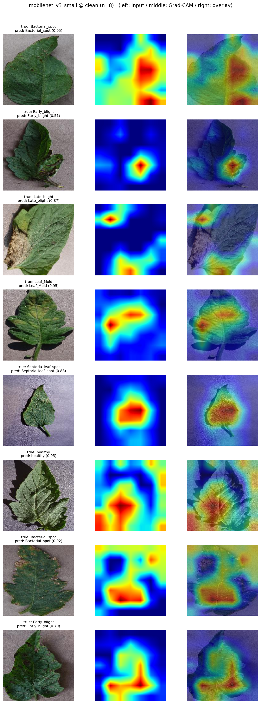
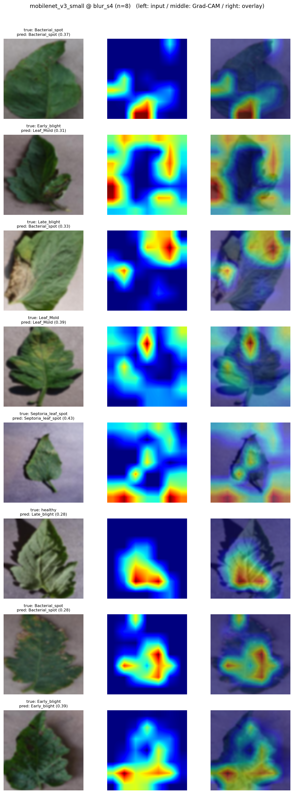

# 可解释性与交互式 Demo

> 本章由 C 负责。结论对应 `results/results.csv` 的 **E1e（mobilenet_v3_small 微调）** 与
> `results/figures/gradcam_mobilenet_v3_small_{clean,blur_s4}.png`，图由 `src/models/gradcam.py` 生成。

## 1. 为什么要看热力图

E1e 在干净测试集上已经到 0.9958 macro-F1，主结果表里的数字无法再区分模型"学到了病斑"还是"学到了拍摄背景"。
第 2 章第 7 节的 E4 跨域实验从**输入侧**给出了怀疑：去掉背景后 macro-F1 掉 33.8 点。
Grad-CAM 从**模型侧**提供第二个视角：如果模型真正依据病斑判别，梯度加权的热区应当落在病斑上。

## 2. 实现

`src/models/gradcam.py` 是一个不依赖第三方 cam 库的最小实现：

| 环节 | 做法 |
|---|---|
| 目标层 | MobileNetV3-Small 的 `features` 最后一个 Conv2d（7×7 特征图） |
| 激活 | forward hook 保存该层输出 |
| 梯度 | 在输出张量上注册 hook，保存 `d(score)/d(activation)` |
| 权重 | 梯度在空间维求均值，得到逐通道权重（Grad-CAM 原始做法） |
| 热图 | 加权求和 → ReLU → 双线性插值回 224×224 → min-max 归一化 |
| 叠加 | `jet` 色图按 α=0.45 叠在反归一化后的原图上 |

两个工程细节：

1. **扰动图不手写**。出图脚本通过 `build_loaders(cfg, corruption=..., severity=...)` 取图，
   与 E3 评测走同一条数据管线，保证"热力图对应的输入"和"评测时的输入"完全一致。
2. **按类轮转抽样**。测试集 CSV 按类别排序，直接取前 N 张会全是同一个类，
   因此按类别轮流取，`--num 8` 时保证 6 个类至少各一张。

## 3. 干净输入 vs 模糊输入

同一批 8 张测试图（seed 42），分别在干净与 `blur, severity=4` 下出图：

| 输入 | 预测正确 | 置信度范围 | 热区形态 |
|---|---|---|---|
| 干净 | 8 / 8 | 0.50 – 0.95 | 集中，多数落在病斑或叶片纹理密集处 |
| 模糊 s4 | 5 / 8 | 0.28 – 0.43 | 明显扩散，部分热区移到叶缘与背景 |



*图 6：干净输入。左为输入，中为 Grad-CAM，右为叠加；行标题为真实类与预测类（括号内为置信度）。*



*图 7：blur severity=4。同一批样本，注意力扩散、置信度整体下滑。*

三点观察：

1. **干净输入下热区基本落在叶片上**，且置信度与热区集中程度正相关（0.95 与 0.50 两行的对比最明显）。
2. **模糊之后热区扩散**，第 2 行的 Early_blight 被误判为 Leaf_Mold、第 6 行的 healthy 被误判为 Late_blight，
   热区都出现"跳出叶片、扫到背景边缘"的现象。这与第 2 章第 6 节的 E3 曲线一致：
   模糊抹掉高频病斑纹理，模型失去最可靠的判别信号。
3. **热图里确实有背景份额**（第 1、7 行的热区都覆盖到台面区域），与 E4 的"背景依赖"结论互相印证。
   需要说明：Grad-CAM 是**相关性证据**而非因果证明——它显示模型输出对哪些空间位置敏感，
   不能单独推出"模型理解了病害"。

## 4. Demo

`app.py` 用 Gradio 提供上传 → 预测 → 热力图的交互：

- **预处理直接复用** `src/data/transforms.py` 的 `build_eval_transform`（Resize 256 → CenterCrop 224 → Normalize），
  尺寸与 mean/std 全部来自 yaml，不在 Demo 里另写一套，避免"演示效果与评测不一致"；
- 输出 Top-3 概率（中文病名 + 原始类名）与 Grad-CAM 叠加图；
- 权重默认取 `runs/e1e_mobilenet_v3_small_ft_r100_s42/best.pth`，模型名从 ckpt 路径推断。

```bash
# 训练（若本地没有权重）
python -m src.train --config configs/e1_mobilenet_v3_small.yaml --seed 42
# 启动 Demo
python app.py --ckpt runs/e1e_mobilenet_v3_small_ft_r100_s42/best.pth --port 7860
```

启动已在 Windows + RTX 4060 Laptop 环境验证：`http://127.0.0.1:7860/` 返回 HTTP 200。
`launch(server_name="127.0.0.1", ...)` 显式绑定回环地址，系统代理开启时不会在 Gradio 启动自检阶段报 502。

## 5. 复现

```bash
# 干净图
python -m src.models.gradcam --config configs/e1_mobilenet_v3_small.yaml \
    --ckpt runs/e1e_mobilenet_v3_small_ft_r100_s42/best.pth --corruption clean --num 8
# 模糊图（扰动图来自 build_loaders）
python -m src.models.gradcam --config configs/e1_mobilenet_v3_small.yaml \
    --ckpt runs/e1e_mobilenet_v3_small_ft_r100_s42/best.pth \
    --corruption blur --severity 4 --num 8
```

`--seed` 固定抽样与热图顺序，同权重下重跑结果一致。
