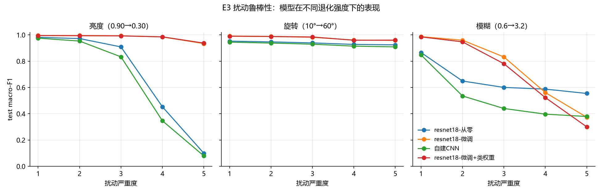
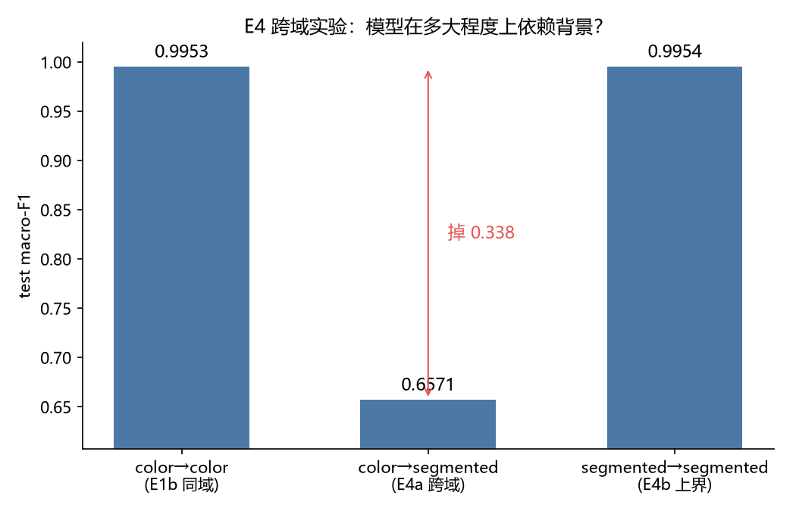

# 实验结果与分析

> 本章由 D 负责。所有数字取自 `results/results.csv`（按 `exp_id` 汇总到 `results/summary.csv`），
> 图由 `scripts/make_figures.py` 从同一份 CSV 生成，可一键复现。
> 当前所有结果均为 **seed 42 单次运行**，标准差尚未统计，见第 8 节的说明。

## 1. 主结果

六个模型在干净测试集（1403 张）上的表现如下，验证集仅用于挑选 `best.pth`：

| 实验 | 模型 | 预训练 | 训练策略 | 参数量 | val acc / macro-F1 | **test acc / macro-F1** |
|---|---|---|---|---|---|---|
| E0 | resnet18 | ✓ | 冻结主干，只训分类头 | 11.18M | 0.8931 / 0.8768 | 0.9009 / 0.8907 |
| E1a | resnet18 | ✗ | 从零训练，basic 增强 | 11.18M | 0.9857 / 0.9843 | 0.9815 / 0.9807 |
| **E1b** | resnet18 | ✓ | 全量微调，basic 增强 | 11.18M | 0.9971 / 0.9971 | **0.9957 / 0.9953** |
| E1c | 自建 CNN | ✗ | 从零训练，basic 增强 | 1.17M | 0.9786 / 0.9779 | 0.9758 / 0.9745 |
| E1d | resnet18 | ✓ | 全量微调 + 类别加权 | 11.18M | 0.9979 / 0.9980 | 0.9950 / 0.9950 |
| **E1e** | mobilenet_v3_small | ✓ | 全量微调，basic 增强 | 1.52M | 0.9929 / 0.9926 | **0.9957 / 0.9958** |

E1b 的逐类召回率均在 0.993 以上（最差类别为 Late_blight 0.9930），六类之间没有明显短板，
说明在**同域（color → color）**条件下，任务本身对当前模型已接近饱和。

## 2. 预训练权重是精度的主要来源

同一骨干、同一增强、同一划分下的三组对照：

| 对照 | test macro-F1 | 差值 |
|---|---|---|
| E0 冻结主干（仅训头） | 0.8907 | 基准 |
| E1a 从零训练全网络 | 0.9807 | +0.090 |
| E1b 全量微调 | 0.9953 | +0.105 |

两个结论：

1. **放开主干比冻结主干值 9 个百分点**——PlantVillage 的判别信息在浅层特征里就有，但需要微调才能适配叶片纹理。
2. **从零训练已经是强基线（0.98）**，只比微调低 1.5 个百分点。这与"自然图像预训练对细粒度分类增益有限"的常见观察一致：数据集规模足够（6544 张训练集）、类间差异明显（病斑形态），从零训练并非不可行。

因此"预训练是否必要"要分开看：同域精度上收益 1.5 点，但在**分布偏移**下的收益远大于此（见第 6、7 节）。

## 3. 模型规模与推理成本

`results/model_cost.csv` 在 RTX 4060 Laptop（batch=1，torch 2.8.0）与同机 CPU 上的实测：

| 模型 | 参数量 | FLOPs | GPU 延迟 | GPU FPS | CPU 延迟 | CPU FPS |
|---|---|---|---|---|---|---|
| 自建 CNN（E1c） | 1.17M | 5.17G | 1.18 ms | 845 | 22.5 ms | 44.5 |
| mobilenet_v3_small（E1e） | 1.52M | 0.11G | 3.98 ms | 251 | 20.8 ms | 48.2 |
| resnet18（E1b） | 11.18M | 3.63G | 1.94 ms | 514 | 28.7 ms | 34.9 |

需要注意的自建 CNN 反常之处：参数量只有 resnet18 的 1/10，但 FLOPs 高出 42%，原因是它在 224×224 分辨率上直接使用大通道卷积，缺乏下采样；
这也解释了它在 CPU 上并不比 resnet18 快多少。mobilenet_v3_small 的 FLOPs 比 resnet18 低 **33 倍**，
但单张延迟反而更慢（3.98 ms vs 1.94 ms），原因是深度可分离卷积的算子效率低、GPU 上无法打满。

**选型建议**：若追求精度上限，用 **E1e（mobilenet_v3_small 微调）**——test macro-F1 0.9958 为全组最高，
参数量仅为 resnet18 的 14%；端侧 CPU 部署二者相差不大（20.8 ms vs 28.7 ms），mobilenet 略优。

## 4. 类别不均衡与类别加权（E1d）

不均衡比 2.2×（第 1 章第 4 节），但 E1b 与 E1d 的差距在 0.0005 以内：

| | val macro-F1 | test macro-F1 |
|---|---|---|
| E1b 不加权 | 0.9971 | 0.9953 |
| E1d `class_weight: balanced` | 0.9980 | 0.9950 |

结论：**在本数据集的规模与类间可分性下，类别加权没有必要**。加权只是把决策边界往小类推，
代价是大类（Bacterial_spot 2127 张）略微受损，净效果在单 seed 噪声范围内。默认配置保留不加权。

## 5. 数据增强消融（E2）

三档增强由 `aug` 名字选择，定义在 `src/data/transforms.py`：

| 档位 | 配方 |
|---|---|
| `none` | Resize(256) + CenterCrop(224) |
| `basic` | Resize(256) + RandomCrop(224) + 水平翻转 0.5 + 垂直翻转 0.2 + 旋转 ±15° + ColorJitter(0.2, 0.2, 0.2, 0.02) |
| `strong` | RandomResizedCrop(224, scale=0.6–1.0) + 水平翻转 0.5 + RandAugment(2, 9) + RandomErasing(0.25) |

四个新配置（`e2a_aug_none`、`e2c_aug_strong` 及其 scratch 版本）与 E1a / E1b 的 `basic` 臂
构成 2×3 网格，全部 seed 42、15 epochs、同一冻结划分：

| 增强 | resnet18 微调 | resnet18 从零 |
|---|---|---|
| none | 0.9892（E2a，val 0.9937） | 0.9621（E2a scratch，val 0.9584） |
| **basic** | **0.9953**（E1b，val 0.9971） | **0.9807**（E1a，val 0.9843） |
| strong | 0.9913（E2c，val 0.9951） | 0.9588（E2c scratch，val 0.9580） |

*表内为 test macro-F1，括号内为 val macro-F1；E2a / E2c 的微调与从零两臂通过 `pretrained` 区分。*

三点观察：

1. **`basic` 在两种训练模式下都是最优点**：相对 `none`，从零训练 +0.0186（远超单 seed 噪声），
   微调 +0.0061（略高于 0.5 点噪声界，但幅度有限）。
   翻转 + 小角度旋转 + 温和色彩抖动补上了 PlantVillage 拍摄角度与光照的多样性，又没有破坏病斑形态。
2. **`strong` 属于过增强**：相对 `basic`，从零训练 −0.0219（明显），微调 −0.0040（在噪声范围内）。
   RandAugment(2, 9) 叠加 RandomErasing 后，判别所需的局部纹理被大量遮盖/扰动，
   在 6544 张训练集规模下从零训练的模型来不及从剩余信息中收敛。
3. **增强的收益与预训练互补**：从零训练从增强中获得 1.86 个点，是微调（0.61 点）的 3 倍，
   说明预训练权重本身已携带平移/色彩不变性，增强对缺少该先验的模型更关键。

一处说明：E3 的鲁棒性曲线用的都是 `basic` 权重，因此**"`strong` 是否用干净精度换来了退化鲁棒性"本组未评测**。
若要回答，需在 `scripts/eval_corruptions.py` 的 `CKPT_BUNDLES` 里加一条 E2c 的配置与权重，
重跑 E3 的 60 组网格，列入后续工作。

## 6. 扰动鲁棒性（E3）

4 个模型 × 3 类扰动 × 5 档严重度，共 60 次评测（参数刻度见第 1 章第 6 节）。
干净测试集（severity = 0）作为每条曲线的起点。同一网格在两名成员机器上各跑过一遍，
60 组结果逐行一致（最大差 0.002），见 PR #7 与本章提交记录的比对说明。

**亮度（brightness，0.90 → 0.30）**

| 模型 | 1 | 2 | 3 | 4 | 5 | 1→5 跌幅 |
|---|---|---|---|---|---|---|
| E1a resnet18 从零 | 0.9815 | 0.9722 | 0.9087 | 0.4553 | 0.1003 | **−0.881** |
| E1b resnet18 微调 | 0.9956 | 0.9951 | 0.9934 | 0.9846 | 0.9331 | −0.062 |
| E1c 自建 CNN | 0.9742 | 0.9532 | 0.8314 | 0.3458 | 0.0794 | **−0.895** |
| E1d resnet18 微调+类权重 | 0.9948 | 0.9939 | 0.9925 | 0.9853 | 0.9368 | −0.058 |

**旋转（rotation，10° → 60°）**

| 模型 | 1 | 2 | 3 | 4 | 5 | 1→5 跌幅 |
|---|---|---|---|---|---|---|
| E1a | 0.9525 | 0.9469 | 0.9392 | 0.9278 | 0.9235 | −0.029 |
| E1b | 0.9915 | 0.9881 | 0.9820 | 0.9607 | 0.9582 | −0.033 |
| E1c | 0.9450 | 0.9379 | 0.9294 | 0.9145 | 0.9090 | −0.036 |
| E1d | 0.9901 | 0.9879 | 0.9843 | 0.9595 | 0.9606 | −0.030 |

**模糊（blur，0.6 → 3.2）**

| 模型 | 1 | 2 | 3 | 4 | 5 | 1→5 跌幅 |
|---|---|---|---|---|---|---|
| E1a | 0.8658 | 0.6491 | 0.6005 | 0.5876 | 0.5556 | −0.310 |
| E1b | 0.9868 | 0.9596 | 0.8324 | 0.5611 | 0.3728 | **−0.614** |
| E1c | 0.8477 | 0.5354 | 0.4392 | 0.3970 | 0.3792 | −0.468 |
| E1d | 0.9850 | 0.9471 | 0.7806 | 0.5229 | 0.3002 | **−0.685** |

*图 2：三种扰动的 macro-F1 随严重度变化。左：亮度；中：旋转；右：模糊。*

三点观察：

1. **亮度是区分"是否预训练"的分水岭**。预训练模型在 0.60 的暗度下几乎不掉点（0.993），
   而两个从零训练的模型在 severity 3→4 之间出现断崖（0.91 → 0.46 / 0.35），最暗处只剩 0.10 / 0.08。
   这不能用"图像变暗 = 像素均值偏移"简单解释：标准 eval 变换里的 ImageNet 归一化对亮度变化是等比例的，
   更可能的原因是预训练权重里已有的、对光照不敏感的颜色/纹理表征，从零训练在 6544 张图上没有学到。
2. **模糊对所有模型都是最难的一类**，且预训练模型的绝对跌幅最大（−0.61 / −0.69），
   但这只是因为它起点高：severity 5 时 E1b（0.373）仍与 E1c（0.379）持平。
   换句话说，模糊把"预训练带来的优势"基本抹平了——细粒度病斑依赖高频纹理，
   高斯模糊直接把判别信号去掉，此时所有模型都接近随机猜测以上的下限。
3. **旋转几乎无影响**（四个模型跌幅均 ≤ 0.036），说明模型对叶片的朝向不敏感，
   这与 `basic` 增强里已有 ±15° 旋转、且叶片本身近似各向同性有关。
4. 类别加权（E1d）对鲁棒性**没有系统性改善**：亮度/旋转与 E1b 相差 ≤ 0.004，模糊甚至略差（−0.685 vs −0.614），
   说明加权只改变决策边界位置，不改变特征对退化的敏感度。

## 7. 背景依赖：color → segmented 跨域（E4）

用 E1b 的权重（在 color 上训练）直接评测 segmented 测试集，与两个同域上界/下界对比：

| 设置 | test acc | test macro-F1 | 相对 ① 的落差 |
|---|---|---|---|
| ① color → color（E1b 同域） | 0.9957 | 0.9953 | — |
| ② color → segmented（E4a 跨域） | 0.6835 | **0.6571** | **−0.338** |
| ③ segmented → segmented（E4b 域内） | 0.9957 | 0.9954 | — |

*图 3：①③ 是两个同域上下界，② 的落差即模型对背景的依赖程度。*

关键判读：

1. **③ 与 ① 几乎相同（0.9954 vs 0.9953）**，排除"segmented 图像本身更难"或"分辨率/预处理不一致"的解释——
   去背景之后的图像依然是可学的，且学得一样好。
2. **② 掉了 33.8 个 macro-F1 点**，远超"轻微分布偏移"的量级，说明 E1b 学到的主要判别依据里有相当一部分来自背景
   （叶片所在的台面、光照色调、拍摄批次等），而不是叶片本身的病斑形态。
3. 逐类召回率（`runs/e4a_color2seg_resnet18_ft_s42/eval.json`）：

| 类别 | 同域召回（E1b） | 跨域召回（E4a） | 主要误判去向 |
|---|---|---|---|
| Bacterial_spot | 0.9969 | 0.8119 | Late_blight（42 张） |
| Early_blight | 0.9933 | 0.9467 | — |
| Late_blight | 0.9930 | 0.9476 | — |
| Leaf_Mold | 0.9930 | **0.2657** | Late_blight（101 / 143） |
| Septoria_leaf_spot | 1.0000 | 0.7218 | Late_blight（62 张） |
| healthy | 0.9958 | **0.2385** | Late_blight（180 / 239） |

   跨域退化不是均匀的：**healthy 与 Leaf_Mold 崩塌最严重，且几乎全部被误判为 Late_blight**。
   这两个类别在原图中与背景的对应关系最强（healthy 叶片多为整片平铺、Leaf_Mold 病斑颜色与背景接近），
   去背景后模型失去了最省力的线索，而 Late_blight 恰好是训练集中样本第三多、病斑面积最大的类别，
   于是成了"默认答案"。

**结论**：模型在 PlantVillage 上 99.5% 的精度，有相当一部分是数据集本身的拍摄偏差贡献的。
把该模型直接部署到真实田间（背景复杂、光照不可控）时，实际精度会显著低于实验值。
这一条应作为本项目的**首要局限性**写进结论，而不是当作一个附加实验。

## 8. 统计可靠性缺口

- 全部结果均为 **seed 42 单次运行**，`summary.csv` 的 `n_seeds` 仍为 1、`acc_std` 为空。
- 因此 **0.5 个百分点以内的差异不可解读**，包括：E1b vs E1d（0.9953 vs 0.9950）、E1b vs E1e（0.9953 vs 0.9958）。
  本章第 4 节的"加权无必要"、第 3 节的"mobilenet 精度略高"都只是在单 seed 下的观察。
- 计划补跑：对 E1a / E1b / E1e 补 seed 0、1，报告均值 ± 标准差；E3 / E4 各补 2 个 seed 以给出曲线误差带。
- 未做的检验：未做配对显著性检验（如 McNemar），也未做多折交叉验证；划分本身是组级去重后的单次划分（第 1 章第 2 节）。

## 9. 小结

| 问题 | 结论 | 证据 |
|---|---|---|
| 该用哪个模型？ | mobilenet_v3_small 微调（E1e）：精度持平 resnet18，参数量 1/7 | 第 3 节 |
| 必须用预训练吗？ | 同域精度只差 1.5 点；但在**亮度**退化下差 80 个点，预训练是鲁棒性来源 | 第 2、6 节 |
| 需要类别加权吗？ | 不需要，差距在 seed 噪声内 | 第 4 节 |
| 数据增强怎么配？ | **`basic` 最优；`strong` 过增强**，从零训练掉 2.2 点 | 第 5 节 |
| 精度可信吗？ | 同域可信；**跨域不可信**，背景依赖导致 −33.8 点 | 第 7 节 |
| 最怕什么退化？ | 模糊 > 亮度（预训练模型）；旋转几乎无影响 | 第 6 节 |
